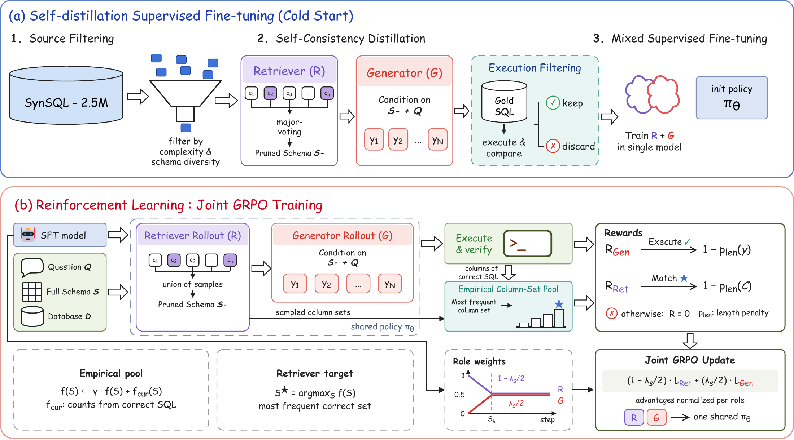

# ACE-SQL

[](LICENSE)

**Adaptive Co-Optimization via Empirical Credit Assignment for Text-to-SQL**

ACE-SQL trains schema retrieval and SQL generation as two roles of one shared language model. Execution-correct SQL rollouts supply adaptive column-set targets for the retriever, while the retriever's selections define the generator's schema context.

This repository follows the **October 9, 2026 manuscript revision**. The training package is built around **slime**, SGLang, and Megatron with direct joint GRPO. See [paper-to-code alignment](docs/paper_alignment.md) for the exact source fingerprints and validation scope. This anonymous release accompanies the October manuscript revision.



## Results reported in the manuscript

Greedy execution accuracy (EX, %); RL rows are means over four seeds.

| Model | BIRD Dev | Spider Dev | Spider Test |
| --- | ---: | ---: | ---: |
| ACE-SQL / Qwen3-4B | 64.7 | 82.6 | 85.9 |
| ACE-SQL / Qwen3-8B | 66.3 | 84.0 | 87.5 |

The 8B model uses **0.87k output tokens per query**, summed across both roles. Training uses **14,184 SFT samples** (7,092 per role) and **2,913 RL questions**. These are manuscript-reported measurements; this repository update did not rerun those experiments. Model weights and per-seed prediction files are not bundled.

## Method

1. **SFT cold start.** Mix model-generated retrieval and execution-filtered SQL samples in one full-parameter fine-tuning run.
2. **Two-pass rollout.** Sample eight retriever outputs per question, take their **union**, and sample eight SQL outputs against that shared pruned schema.
3. **Online empirical target.** Count column sets from execution-matched SQL, update `pool = 0.5 * historical_pool + current_counts`, then read the most frequent set. All tied maximum-frequency sets are accepted.
4. **Sparse rewards.** Give the generator execution-match reward and the retriever exact-target reward. Only matched outputs receive the length penalty: zero up to 512 tokens, increasing linearly to 0.5 at 2,048 tokens.
5. **Joint update.** Normalize advantages separately for each question and role. Combine the two role losses as `(1 - lambda/2) * L_ret + (lambda/2) * L_gen`, with `lambda` rising from 0 to 1 over the first 25% of RL steps. Apply one optimizer update to the shared policy. No gradient projection is used.

Evaluation uses one greedy retrieval followed by one greedy SQL generation. Evaluation does not update the pool.

## Repository structure

The runtime is an installable `ace_sql` package. Slime owns distributed training and checkpoint tensors; ACE-SQL owns two-role sampling, credit assignment, per-role objectives, and reproducible question/pool state.

| Path | Responsibility |
| --- | --- |
| `src/ace_sql/data/` | Released-row validation, tokenizer filtering, conversion, database resolution |
| `src/ace_sql/schema/` | Shared column parsing, schema union, DDL and prompt resources |
| `src/ace_sql/rewards/` | SQLite execution, result comparison, empirical counts and retrieval/SQL rewards |
| `src/ace_sql/training/` | Slime data source/rollout/loss hooks, experiment configuration and HF export checks |
| `src/ace_sql/runtime/` | Pinned environment validation, metadata patch, reference/data preparation |
| `src/ace_sql/evaluation/` | Shared-policy inference, BIRD/Spider/robustness pipelines and benchmark evaluators |
| `configs/` | Slime paper/control experiments, LLaMA-Factory SFT and evaluation settings |
| `data/` | Immutable SFT/RL data; hashes in [data manifest](docs/data_manifest.json) |
| `tests/` | CPU method, package, pipeline and pinned upstream contract checks |
| `docs/`, `audits/` | [Architecture](docs/architecture.md), [paper mapping](docs/paper_alignment.md), data provenance and historical audits |

The legacy `RL/`, `SFT/`, and `EVAL/` trees are removed. The vendored verl trainer, PCGrad path, duplicate reward manager, and FSDP/LoRA checkpoint-merging workflow are available only in Git history. The retained third-party Spider evaluator has its original license.

## Install and preview

From the repository root, in a Python 3.11+ environment:

```bash
python -m pip install -e .
ace-sql train --config configs/slime/paper.toml --dry-run
ace-sql prepare --config configs/slime/paper.toml --dry-run
```

Commands can run outside the checkout: `ace-sql --project /path/to/ACE-SQL train --dry-run`. Runtime assets resolve against `--project`, `ACE_SQL_HOME`, or the working directory. Package installation does not install a GPU framework or copy datasets into site-packages.

## Train and evaluate

Use separate environments for SFT, slime training, and vLLM evaluation. Supply model checkpoints and SQLite databases as described in [data.md](docs/data.md).

```bash
# SFT in a LLaMA-Factory environment: eight GPUs, one epoch.
bash scripts/train_sft.sh model_name_or_path=/path/to/Qwen3-8B

# RL on the pinned Linux/H20 runtime; inspect paths before running.
export ACE_SQL_CONFIG="$PWD/configs/slime/paper.toml"
export ACE_SQL_MODEL_PATH=/assets/models/sft_checkpoint
export ACE_SQL_REFERENCE_PATH=/assets/models/sft_torch_dist
export ACE_SQL_TRAIN_DB_ROOT=/assets/databases/train
export ACE_SQL_DEV_DB_ROOT=/assets/databases/dev
bash scripts/container.sh train
```

The container installs the package, validates the pinned stack, applies the reviewed metadata patch, prepares the reference checkpoint/data, and runs slime. See [training](docs/training.md) and [runtime](docs/runtime.md) for controls, recovery, mounted assets and validation limits.

```bash
# In an evaluation environment with a compatible vLLM installation:
python -m pip install -e '.[evaluation]'
export BIRD_DEV_DATA=/path/to/bird/dev.json
export BIRD_TABLES=/path/to/bird/dev_tables.json
export BIRD_DB_PATH=/path/to/bird/dev_databases
ace-sql eval-bird --model /path/to/run/hf/rollout_80 --output .runs/bird_80
```

Both roles use the same complete HF export. Greedy decoding is the default. [Evaluation documentation](docs/evaluation.md) includes Spider and two-stage robustness evaluation. Training compares ordered results with a 30-second SQL timeout; BIRD retains its benchmark set comparison and 180-second timeout.

## Verification and source releases

```bash
python -m pip install -e '.[test]'
make syntax test verify
# Stage the intended files before building an archive from Git's inventory.
python scripts/build_release.py --output-dir /path/to/release
```

CPU checks include SQLite rewards, role-separated advantages, weighted PPO/KL, rollback and checkpoint replay, configuration validation, installed resources, and a BIRD pipeline with only model responses mocked. Optional pinned upstream checks are described in [training.md](docs/training.md). **GPU training, distributed synchronization and manuscript scores have not been revalidated by this refactor.**

## License and dependencies

Project code is under the [MIT License](LICENSE); bundled third-party code retains its own license. Dataset and base-model use is subject to the original sources' terms.

Built with [Qwen3](https://github.com/QwenLM/Qwen3), [LLaMA-Factory](https://github.com/hiyouga/LLaMA-Factory), [slime](https://github.com/THUDM/slime), [SGLang](https://github.com/sgl-project/sglang), and [Megatron-LM](https://github.com/NVIDIA/Megatron-LM). Evaluation uses [vLLM](https://github.com/vllm-project/vllm) and the [BIRD](https://bird-bench.github.io/) and [Spider](https://yale-lily.github.io/spider) benchmarks.
